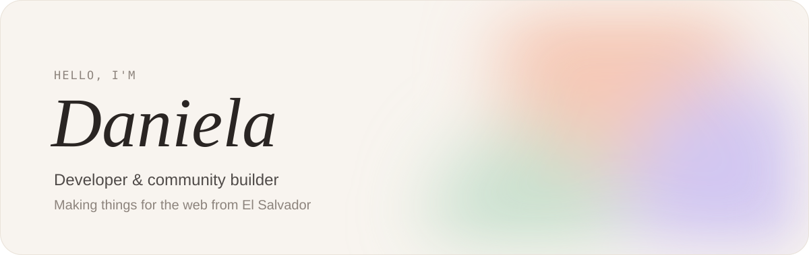
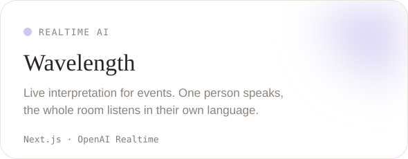
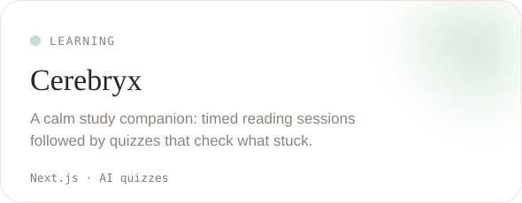
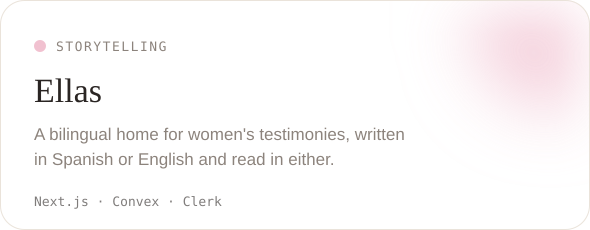
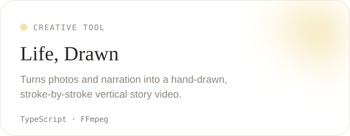

<picture>
  <source media="(prefers-color-scheme: dark)" srcset="assets/header-dark.svg">
  
</picture>

 

I'm a full-stack developer who mostly writes TypeScript. I like building small, thoughtful products, and lately a lot of them have some AI inside.

When I'm not coding, I'm helping grow the dev community in El Salvador with [Ai Labs](https://www.ailabs.sv/): meetups, hackathons, and workshops where the slides are usually a little too interactive.

[dhuezo.dev](https://dhuezo.dev/en) &nbsp;·&nbsp; [Ai Labs](https://www.ailabs.sv/)

 

### Things I've made

  <a href="https://github.com/irenehl/wavelength"><picture><source media="(prefers-color-scheme: dark)" srcset="assets/wavelength-dark.svg"></picture></a>
  <a href="https://github.com/irenehl/cerebryx"><picture><source media="(prefers-color-scheme: dark)" srcset="assets/cerebryx-dark.svg"></picture></a>
  <a href="https://github.com/irenehl/unheard"><picture><source media="(prefers-color-scheme: dark)" srcset="assets/ellas-dark.svg"></picture></a>
  <a href="https://github.com/irenehl/draw-my-life"><picture><source media="(prefers-color-scheme: dark)" srcset="assets/life-drawn-dark.svg"></picture></a>

 

### Around the community

- **Cursor Buildathon & Hackathon SV**: organizing, plus the slides and live demos
- **OpenAI DevDay Exchange San Salvador**: talks and Codex demos
- **Clerk Meetup**: hands-on session on auth
- **Git & GitHub for beginners**: a workshop designed like a video game

 

### Tools I reach for

TypeScript, Next.js, React, NestJS, Node, GraphQL, Postgres, Convex, Tailwind, and whichever AI API fits the idea.

 

Always happy to chat about community, side projects, or a good coffee spot in San Salvador.
